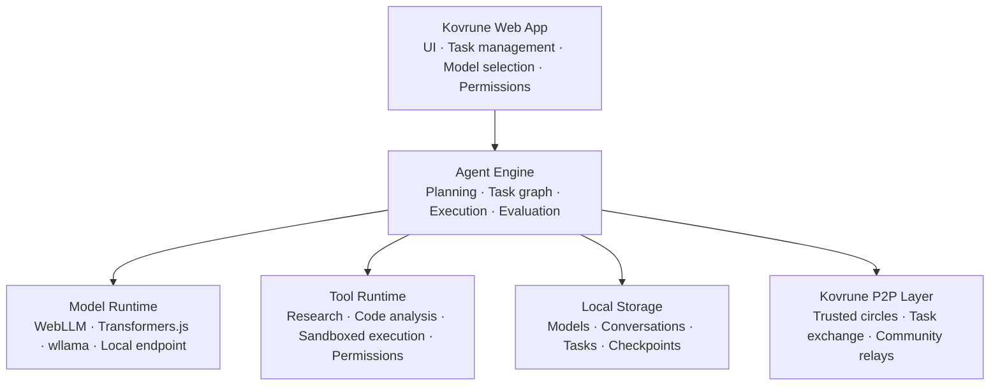
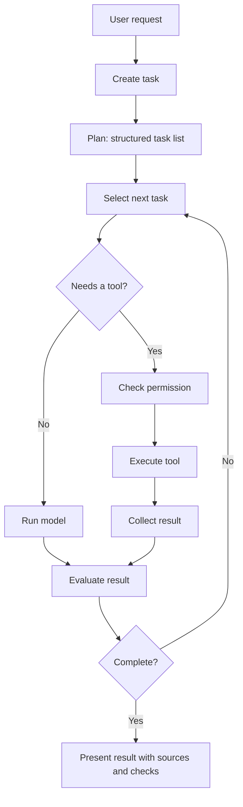

# Kovrune — Project Design

**Your documents. Your machine. Answers you can check.**

An open-source, local-first research app: answers about the user's own documents and open scholarly sources, with every quote checked against its source, from a model on the user's own machine. Coding agents and collaboration in trusted circles are planned later milestones (§12).

| | |
| --- | --- |
| Status | Draft, revision 4 (roadmap re-planned for a team of two, with a go/no-go for M3; see §0) |
| License | MPL-2.0 (see [`LICENSE`](../LICENSE)) |
| Scope of this document | Product definition, architecture, security model, and roadmap |

Kovrune is built around a simple idea: people should be able to run their own AI agents, choose their own models, and collaborate with people they trust without depending on a centralized AI provider.

Today, a user opens Kovrune in a browser, picks a compatible model from Hugging Face (or points Kovrune at a model server they already run), and runs a research agent locally over their documents and open sources. Later milestones add work on software and exchanging tasks with peers they have invited.

---

## 0. Revision notes

**Revision 4** re-plans the roadmap for the actual team of two ([issue #36](https://github.com/bowo-prasetyo/kovrune/issues/36)). §12 has new estimates, which separate what Claude builds from what waits on people. It proposes an order after M1 (M2 next, M2.5 on hold) and adds a go/no-go gate for M3, decided by interviews whose rule is fixed in advance ([`circles-interviews.md`](circles-interviews.md)). Using a model server on another computer of the user's own is documented in the user guide, as the path that needs no P2P work.

Revision 3 narrows the positioning to what M1 ships. The product is described as a local-first research app with checked quotes; the coding agent and trusted circles are presented as roadmap, not as current features (§1.4–1.5). §1.4 names the first audience: technical researchers who are comfortable with a terminal. Sections that describe the full design now also say what M1 actually ships: §2.1 has an M1 column, and §3.2, §3.4, §7.4, §10 and §12 note where M1 differs, for example the GitHub Pages preview and model downloads that are not yet pinned or verified. The project motto, *Think Freely. Build Together. Stay Decentralized.*, describes the long-term vision in §1.1 and is unchanged.

Revision 2 followed a product and feasibility audit of the first draft. The main changes:

| Change | Why |
| --- | --- |
| Added **target users, positioning, and success metrics** (§1.4–1.6) | The first draft had no audience, no competitive framing, and no measurable success criteria. |
| Added **M0: benchmark gate** before any product build (§12) | Agent quality on browser-sized models is the project's largest risk and was previously untested until late milestones. |
| **WebLLM is the primary LLM runtime**; Transformers.js handles embeddings and small task models; GGUF via wllama in advanced mode (§3) | The first draft assigned runtimes in an order that does not fit the generation-heavy agent workload. |
| Added a **local endpoint adapter** (Ollama, LM Studio, llama.cpp server) in M1 (§3.6) | Gives users with capable hardware much larger models while staying local and user-controlled. |
| **Structured / grammar-constrained output** is part of the model interface (§3.3) | Small models produce unreliable tool calls without it. |
| **Research scope narrowed** to CORS-friendly sources plus user documents (§5.1) | Browsers cannot fetch most of the web; a mandatory proxy would reintroduce central infrastructure. |
| **In-browser code execution** (Pyodide, QuickJS) moved forward to M2.5 (§5.2) | Verification of code without execution relies on model opinion only. |
| **P2P scoped to trusted circles**; open participation deferred (§6) | Browser peers are ephemeral, there is no contribution incentive, and open participation carries abuse risk. |
| Tool interface aligned with **MCP**; task protocol informed by **A2A** and **Nostr NIP-90** (§4.3, §6.4) | Avoid inventing protocols that already exist. |
| **Prototype transport is lightweight WebRTC**; js-libp2p is adopted only if the prototype shows demand (§6.1) | Answer the product question faster and with a smaller bundle. |
| Added **supply-chain and hosting security** (§7.3–7.4) and moved hosting off GitHub Pages | The app holds keys and private data; GitHub Pages cannot set COOP/COEP or full CSP headers. |
| **License settled as MPL-2.0** (§13) | The repository already uses MPL-2.0. |
| Download integrity verification is **required** (§3.4) | Hugging Face exposes per-file SHA-256 for LFS files, so the cost is low. |

---

## 1. Vision, principles, and product definition

### 1.1 Vision

Build a decentralized environment in which independent AI agents, each controlled by its owner, can cooperate on work that benefits from multiple perspectives, specialized capabilities, or uneven hardware.

For example, a Kovruner developing a software application might ask their local agent to:

- Research libraries and compare technical approaches.
- Run generated tests in a local sandbox.
- Ask a teammate's more capable agent to review a proposed change.
- Combine the findings into a coherent implementation plan.
- Verify the result before accepting it.

Each peer retains control of its own machine, models, data, permissions, and participation.

### 1.2 Core principles

- **Decentralized by design.** No central AI inference service and no mandatory company-operated task broker. Community-operated discovery and relay infrastructure can help peers connect.
- **User-selected AI models.** Users choose compatible models from Hugging Face, or their own local model server, rather than being locked into one vendor or model family.
- **Local control and privacy.** Private data and tasks stay on the user's device unless the user explicitly authorizes sharing.
- **Open and extensible.** The agent framework, peer protocol, model adapters, and tools are inspectable and replaceable, and reuse open standards where they exist.
- **Verification over blind trust.** Results from local and remote agents are proposals that may require testing, execution, or independent review.
- **Measured claims.** Kovrune does not claim that a model, browser, or network feature is supported until it has been tested under documented conditions.

### 1.3 What Kovrune is not

- Not a proprietary cloud AI service.
- Not a blockchain or cryptocurrency project.
- Not a system that requires anyone to share computing resources.
- Not a promise that every Hugging Face model can run in a browser.
- Not an open marketplace where any stranger's agent is trusted or can submit work.

A browser-first architecture reduces deployment friction but introduces constraints around memory, compute, storage eviction, background execution, cross-origin requests, and peer connectivity. Kovrune is designed around those constraints rather than hiding them.

### 1.4 Target users

The first audience is **technical researchers: privacy-conscious researchers and developers who are comfortable with a terminal**, on reasonably capable laptops or desktops:

- They want AI help with literature, technical research, and their own documents without sending data to a hosted provider.
- They can install and start a local model server by following written steps (the user guide's llama.cpp setup), or already run llama.cpp, Ollama or LM Studio. They are comfortable downloading a multi-gigabyte model.
- Some work in small groups (a lab, a team, an open-source project) and would share work with people they know.

This audience can use Kovrune on every supported machine today: in the browser where the GPU allows, and through a local model server everywhere else, including class 1 laptops.

People who won't use a terminal are **not** the first audience. They could use only the browser path, which needs a capable GPU and is not yet measured on class 2 hardware ([issue #9](https://github.com/bowo-prasetyo/kovrune/issues/9)). They become a target once the browser path is confirmed and setup needs no terminal on the machines they use. "Ordinary users" on low-memory devices and phones are not the first audience either. Realistic minimum hardware for the browser runtime is roughly 8 GB of RAM and a WebGPU-capable browser; the exact floor is set by the M0 benchmark (§12).

**Primary job to be done:** "Help me answer a question from my own documents and open scholarly sources, using a model I control, with quotes I can check."

A second job, "help me work on a codebase", is the target of the coding agent (M2.5) and is not part of the current product.

### 1.5 Positioning

| Alternative | What it offers | Where Kovrune differs |
| --- | --- | --- |
| Hosted assistants (cloud chat products) | Strong models, zero setup | Documents leave the device; vendor lock-in; citations are not checked against the source |
| WebLLM Chat and similar demos | In-browser chat | No research loop over documents and sources, no quote checking |
| Ollama + Open WebUI, Jan, LM Studio | Local models with a good UI | General chat rather than a research workflow whose quotes are checked; the app itself needs installing |

Kovrune's position: **private research over your own documents and open scholarly sources, with every quote checked against its source, from a model on your own machine: in the browser where the GPU allows, or on your own model server.**

The browser path needs no installation, but only on capable GPUs, and that is not yet measured on class 2 hardware (§12, M0 outcome). On other machines the user installs a local model server. If the class 2 run fails, the browser is no longer presented as the default path, and the position becomes "local-first, in the browser when your GPU allows".

Later milestones are compared with different alternatives:

| Milestone | Alternative | Where Kovrune would differ |
| --- | --- | --- |
| Coding agent (M2.5) | Local coding agents (Aider, Cline, OpenHands) | Browser path with sandboxed test runs; collaboration within circles |
| Trusted circles (M3+) | Volunteer compute networks (AI Horde, Petals) | Shares agent tasks with invited peers, not raw compute; no brokers or incentives |

### 1.6 Success metrics

| Metric | Target for community preview |
| --- | --- |
| Task success rate on the Kovrune evaluation set (§11.2) | Published per model and hardware class; no regression between releases |
| Time from first visit to first useful result | Under 15 minutes on reference hardware, including model download |
| Model download completion rate | Above 90% of started downloads |
| Valid tool-call rate | Above 95% with constrained decoding on catalog models |
| **False reassurance rate:** the share of answers labelled **Quotes found** that are wrong or only partly right | Under 10% on Qwen3.5-4B, tracked between harness versions. Measured by the benchmark (a labelled answer whose task fails), the usability test, and the live checks. Baseline: 3 of 22 (14%) in the last recorded Qwen3.5-4B report, harness 0.6.0 |
| 7-day and 30-day retention | Tracked with opt-in, privacy-preserving telemetry only |
| Trusted-circle usage (after M4) | Number of circles with at least one delegated task per week |

**Quotes found** is the label a reader is most likely to take as "the answer is right", so the false reassurance rate is the measure of Kovrune's core promise. The label means every quote is in its source and every judged sentence of the answer is backed by one (`labelledQuotesFound` in `src/agent/support.ts`); the benchmark and the app use the same rule.

Telemetry is **off by default** and opt-in only. Without it, these metrics come from voluntary reports and the evaluation set.

---

## 2. Overall system architecture

Kovrune is a static web application with a modular architecture. Optional companions (a local model server, a retrieval companion) can extend it without being required for the basic experience.



The central architectural rule: **the agent engine does not depend directly on a particular model runtime, tool implementation, or network transport.** Each is reached through an interface, so runtimes, tools, and transports can be replaced without rewriting the engine.

### 2.1 Technology stack

| Component | Choice | Purpose | In M1 |
| --- | --- | --- | --- |
| Language | TypeScript | Shared application and protocol types | Used |
| UI | React with Vite | Static browser application, installable as a PWA | Used; not yet installable as a PWA |
| LLM inference (primary) | WebLLM | Fast in-browser text generation with JSON-schema and grammar-constrained decoding | Used for the browser path |
| Embeddings, rerankers, small task models | Transformers.js | ONNX models via WebGPU or WASM | Not shipped. Search uses keywords with stemming; revisit after M1 if keyword search proves the bottleneck |
| GGUF models (advanced mode) | wllama (llama.cpp compiled to WebAssembly) | Access to the most common quantized format on Hugging Face | Not shipped in the app; used only by the M0 benchmark. Revisit if its WebGPU and CPU performance improve |
| Local model servers | OpenAI-compatible HTTP adapter | Ollama, LM Studio, llama.cpp server on the user's machine or LAN | Used. llama.cpp server is supported, Ollama is experimental, LM Studio is untested |
| Model downloads | Hugging Face Hub file API | Discovery, pinned revisions, per-file SHA-256 | M1 downloaded the `main` revision without hash checks. Since M2 slice 1, catalog models are pinned and every file is checked (§3.4); discovery is not built |
| Local persistence | IndexedDB for structured data; OPFS / Cache Storage for large files | Tasks, settings, model files | Settings in `localStorage`; model files in WebLLM's browser cache; documents' extracted text and past answers in IndexedDB. Tasks are not checkpointed (M2) |
| Background processing | Web Workers | Keep the UI responsive during inference and execution | WebLLM runs in a worker |
| Code execution | Pyodide (Python), QuickJS-wasm (JavaScript), in sandboxed workers | Running generated tests locally | M2.5. The benchmark runs coding tasks in a plain worker, which is not a security boundary |
| Tool schema | MCP-compatible tool definitions | Reuse the existing tool ecosystem | Tools are defined with Zod and sent to the model as JSON Schema; no MCP integration yet |
| P2P (prototype) | WebRTC data channels with pluggable signaling (e.g. Trystero) | Fast validation of trusted-circle collaboration | M3 |
| P2P (if adopted) | js-libp2p with WebRTC, WebTransport, and circuit relay | Production transport, community relays | Decided in M4 |
| Data validation | Zod | Validate every external message and tool input | Used |
| Testing | Vitest and Playwright | Unit, integration, cross-browser end-to-end | Node's built-in test runner for unit tests; end-to-end checks in headless Chromium are run by hand, not in CI |
| Hosting | Cloudflare Pages or Netlify (custom headers), with signed, reproducible builds | See §7.4 | An unsigned preview on GitHub Pages; the target host and signed builds are M2 (§7.4) |

These are starting choices. Package versions and browser compatibility are verified at the start of each milestone.

---

## 3. Model ecosystem

### 3.1 Model selection experience

The user opens the model library and sees models organized by purpose (chat, code, research, embeddings), runtime, resource requirements, and license. For each model they can:

1. Search a curated catalog of tested models.
2. Inspect the model card, license, files, and resource requirements.
3. See whether the model is expected to run on their browser and hardware, based on detected capabilities and the published benchmark matrix.
4. Download the model with progress, cancellation, and resume.
5. Reuse the downloaded model across tasks.
6. Switch models without losing conversations or task history.
7. Remove downloaded model files to free storage.

The catalog contains only model IDs and immutable revisions that have passed the Kovrune evaluation set on at least one reference hardware class.

### 3.2 Hugging Face is a model hub, not a universal browser runtime

A repository of standard PyTorch weights does not mean those weights run in a browser. Kovrune therefore uses an adapter per runtime and never assumes a repository is loadable.

| Runtime | Used for | Formats |
| --- | --- | --- |
| **WebLLM** (primary LLM runtime) | Agent planning, generation, tool calls | MLC-compiled model libraries and weights |
| **Transformers.js** | Embeddings, reranking, classification, small helper models | ONNX |
| **wllama** (advanced mode) | Running arbitrary compatible GGUF language models | GGUF |
| **Local endpoint** | Larger models on the user's own server | Whatever the server supports |
| **Browser built-in AI** (optional, experimental) | Zero-download fallback where available | Vendor-provided; labeled clearly as a vendor model |

M1 ships two of these: WebLLM and the local endpoint (§2.1).

### 3.3 Common model interface

All runtimes implement one application-facing interface. Compared with the first draft, it adds context limits, token counting, structured output, and capability flags, because an agent cannot work reliably on small models without them.

```ts
export type Runtime =
  | "webllm"
  | "transformers-js"
  | "wllama"
  | "local-endpoint"
  | "browser-builtin";

export interface ModelInfo {
  id: string;
  repoId?: string;            // absent for local endpoints
  revision?: string;          // immutable commit for Hub models
  runtime: Runtime;
  capabilities: Array<"chat" | "code" | "embeddings" | "tool-calls" | "structured-output">;
  contextLength: number;
  downloadBytes?: number;
  memoryEstimateBytes?: number;
  license?: string;
  files?: Array<{ path: string; sha256: string; bytes: number }>;
}

export interface ChatMessage {
  role: "system" | "user" | "assistant" | "tool";
  content: string;
  toolCallId?: string;
}

export interface GenerationRequest {
  messages: ChatMessage[];
  maxTokens: number;
  temperature?: number;
  /** Constrain output to a JSON schema (tool calls, plans, verdicts). */
  responseSchema?: unknown;
  /** Tools the model may call; MCP-compatible definitions. */
  tools?: ToolDefinition[];
  signal?: AbortSignal;
}

export interface GenerationChunk {
  text: string;
  done: boolean;
  usage?: { promptTokens: number; completionTokens: number };
}

export interface LanguageModel {
  readonly info: ModelInfo;
  generate(request: GenerationRequest): AsyncIterable<GenerationChunk>;
  countTokens(messages: ChatMessage[]): Promise<number>;
  supportsConstrainedDecoding(): boolean;
  dispose(): Promise<void>;
}

export interface EmbeddingModel {
  readonly info: ModelInfo;
  embed(texts: string[], signal?: AbortSignal): Promise<Float32Array[]>;
  dispose(): Promise<void>;
}

export interface ModelProvider {
  readonly runtime: Runtime;
  checkCompatibility(model: ModelInfo): Promise<{ compatible: boolean; reasons: string[] }>;
  loadLanguageModel?(model: ModelInfo): Promise<LanguageModel>;
  loadEmbeddingModel?(model: ModelInfo): Promise<EmbeddingModel>;
}
```

When a runtime cannot constrain decoding, the engine falls back to parse-validate-retry with a strict retry budget, and records the failure rate per model.

The agent engine talks only to `LanguageModel` and `EmbeddingModel`.

### 3.4 Catalog entries and downloads

Each catalog entry records:

- Repository ID and immutable commit revision.
- Runtime and model format.
- Required files with **SHA-256 hashes and sizes**, taken from the Hugging Face tree API for the pinned revision.
- Quantization and data types.
- Download size, estimated memory, and context length.
- Capabilities and measured evaluation results per hardware class.
- Declared license with a link to its terms; missing or ambiguous licenses are flagged.
- Model card URL and known limitations.

**In M1** this was not implemented: WebLLM fetched model weights from the `main` revision on Hugging Face and its compiled model libraries from the `main` branch of `mlc-ai/binary-mlc-llm-libs` on GitHub, without checking hashes.

**Since M2 slice 1**, the browser catalog models are pinned and verified:
- **Pinned:** `src/models/browser-manifest.ts` records, for each model, a Hugging Face commit, a `binary-mlc-llm-libs` commit, and the SHA-256 and size of every file WebLLM downloads. `npm run pin:browser-models` generates it; re-running it is a deliberate model update, reviewed like code.
- **Code and config checked before use:** WebLLM's own `integrity` option checks the chat config, the tokenizer and the model library (WebAssembly) before using them.
- **Weights checked before use:** WebLLM stores the tensor index and weight shards through the Cache API as they arrive, without a hook to check them. Kovrune hashes them after the load, before the model is handed to the app. A file that fails is deleted with the rest of the model, and the load fails. So the weights reach GPU memory before the check, but are never used unchecked. Passed files are recorded, so later visits don't hash gigabytes again.
- **Existing downloads:** files downloaded under the `main` URLs in M1 are moved to the pinned URLs when their hashes match, and deleted otherwise, so testers don't download the same model twice.
- Models outside the catalog, which only the M0 benchmark page offers, still load from WebLLM's prebuilt list.

Download workflow:

1. Resolve the pinned revision and its file manifest.
2. Show license, download size, estimated memory, and storage required.
3. Request persistent storage (`navigator.storage.persist()`) and check the available quota.
4. Download with progress, cancellation, retry, and resume.
5. **Verify every file against its SHA-256.** A file that fails verification is deleted and never loaded.
6. Mark the model installed only when all required files are verified.
7. Load the model in a worker and run a short smoke test.

Storage and security rules:

- Storage can be evicted. Safari may clear script-written storage after 7 days without use unless the app is installed; the UI must handle re-downloading gracefully.
- Detect quota errors and offer to remove unused models.
- **Since M2 slice 3:** the research screen's **Storage and backup** section shows usage and quota, whether the browser agreed to persist the data, and the downloaded models with their sizes and a delete button. A backup file holds documents and answers and restores into any browser, adding only what is missing. Quota errors when saving name the cause and point to that section. Eviction itself can't be detected (the browser clears the record of what was there with the data), so the defences are the persistence request and the backup.
- Never embed a private Hugging Face token in the app. Gated repositories use the user's own token, stored locally and sent only to Hugging Face.
- Treat downloaded configuration files and metadata as untrusted input.
- Never treat repository contents as permission to execute code.

### 3.5 Arbitrary Hugging Face repositories

- **Standard mode:** curated, tested catalog only.
- **Advanced mode:** the user enters a repository ID. Kovrune inspects the metadata, identifies a supported runtime and format (MLC, ONNX, or GGUF), estimates memory, and explains any missing requirements. Unverified models are labeled as such and are excluded from published evaluation claims.

### 3.6 Local endpoint adapter

Users who already run Ollama, LM Studio, or a llama.cpp server can connect Kovrune to it through an OpenAI-compatible adapter. This is part of **M1**, not a later extension.

- The endpoint is on the user's machine or LAN and is configured by the user.
- Setup guidance covers cross-origin configuration (for example `OLLAMA_ORIGINS`) and the browser's local-network-access permission prompt.
- The adapter reports the model's context length and whether structured output is supported.
- Hosted third-party APIs are **not** a supported runtime. A user can technically point the adapter at any compatible URL, but Kovrune does not ship presets for commercial providers and warns when the endpoint is not local.

This makes 8–70B-parameter models available to users with suitable hardware, which is expected to be the main path for demanding agent work.

---

## 4. Agent engine

The model generates text. The agent engine turns that text into controlled, bounded actions and checked results.

### 4.1 Execution loop



Components:

- **Planner:** produces a schema-constrained task list. Plans are shallow by default (one planning step, a small number of tasks); deeper decomposition is enabled per model only when the evaluation set shows it helps.
- **Task graph:** records dependencies, parallelizable work, and execution state.
- **Executor:** runs model calls and tools.
- **Tool registry:** lists available tools, their schemas, and required permissions.
- **Evaluator:** checks results against explicit criteria. Prefers objective checks (tests passed, source contains the quoted passage, schema valid) over model self-assessment.
- **Memory manager:** selects relevant context within the model's measured context length, using embeddings for retrieval.
- **Checkpoint manager:** persists progress so interrupted tasks can resume.

Every loop has hard limits: iterations, tokens, elapsed time, tool calls, and retries, plus optional user budgets.

### 4.2 Task states

`created → planned → ready → running → evaluating → completed`

Other states: `paused`, `interrupted`, `failed`, `cancelled`.

Tasks resume after a tab closes or the browser restarts when their state has been persisted. The browser cannot guarantee background execution, so the UI clearly distinguishes saved work from work that is actively running.

### 4.3 Tool interface

Tools use MCP-compatible definitions (name, description, JSON Schema input) so that existing tool descriptions and, later, MCP servers can be reused.

```ts
export interface ToolDefinition {
  name: string;
  description: string;
  inputSchema: JSONSchema;     // published to the model and to MCP clients
}

export interface AgentTool<Input, Output> extends ToolDefinition {
  validator: z.ZodType<Input>; // runtime validation; the JSON Schema is generated from it
  requiredPermissions: Permission[];
  execute(input: Input, context: ToolContext): Promise<Output>;
}
```

- Inputs are validated at runtime; TypeScript types alone are not trusted.
- Permissions are checked by the registry before `execute`, based on the tool and the resolved inputs (for example, which URL host or which file). A model cannot gain access by generating different arguments.
- Tool output returned to the model is marked as data, not instructions (§7.2).

---

## 5. Research and software development tools

### 5.1 Research agent

The research agent searches accessible sources, extracts passages and metadata, compares claims, keeps source URLs and retrieval timestamps, identifies uncertainty and contradictions, and produces structured findings with citations.

**Scope for the MVP:** browsers can only fetch resources that allow cross-origin requests. Kovrune does not run a proxy. The MVP therefore supports:

- User-provided documents (PDF, Markdown, HTML, text) and pasted content.
- CORS-friendly scholarly and technical APIs, for example Wikipedia, OpenAlex, Crossref, arXiv metadata where reachable, the GitHub API, and the Hugging Face Hub.
- Search providers that allow browser access with the user's own API key, where available.

The product is positioned as **scholarly and technical research**, not general web browsing. Each source adapter declares what it can reach, and the UI explains when a URL cannot be fetched and offers to import it manually.

**Later, optional:** a self-hostable retrieval companion that the user (or a trusted circle) runs, for general web fetching. Kovrune does not operate one centrally.

### 5.2 Software development agent

The coding agent can explain code, identify likely defects, propose patches, generate tests, review changes against acceptance criteria, compare alternatives, and keep a change log.

Inputs:

- Files uploaded or pasted by the user (all browsers).
- A local directory opened with the File System Access API (Chromium-based browsers only; other browsers fall back to upload).
- Public GitHub repositories via the GitHub API.

**Sandboxed execution (M2.5):** generated tests and small programs run inside dedicated workers:

- Python via Pyodide.
- JavaScript via QuickJS-wasm, isolated from the application's own JavaScript context.
- No network access from the sandbox by default; time and memory limits enforced.

This gives the verification agent objective signals (tests pass or fail) instead of relying on model opinion. Full toolchains (compilers, package installs, containers) remain out of scope for the browser and belong to a later optional local companion. WebContainers are not used as a core dependency because commercial use requires a license from their vendor.

### 5.3 Verification agent

A separate verification role checks:

- That every claim has a supporting source and that quoted passages appear in it.
- That proposed patches pass the generated and existing tests where execution is available.
- That tests cover the stated requirements.
- Unsupported assumptions and checklist compliance.

When possible, verification uses a different model, or a larger model via the local endpoint, from the one that produced the result. Verification improves reliability; it does not guarantee correctness, and the UI says so.

---

## 6. Peer-to-peer collaboration

### 6.1 Scope: trusted circles first

The P2P layer is scoped to **trusted circles**: small groups whose members invite each other (a lab, a team, a project's maintainers). Open participation by unknown peers is deferred until there is evidence of demand and a defensible abuse model.

Reasons:

- **Availability:** a browser peer exists only while its tab is open; background tabs are throttled and mobile browsers suspend them. An open network of browser peers will be small and unreliable.
- **Value:** delegating to a stranger running the same small model adds little besides parallelism, and costs privacy. Delegation is valuable when the peer has **more capability** (for example, a desktop serving a large model through the local endpoint adapter) or **more context** (a teammate who knows the codebase).
- **Incentives:** Kovrune has no token economy. Within a circle, people help each other for the same reasons they review each other's code.
- **Risk:** open participation invites spam, Sybil identities, prompt-injection attacks, and liability for content generated on behalf of strangers.

### 6.2 Transport

- **Prototype (M3):** WebRTC data channels with pluggable signaling (for example Trystero over public signaling channels, or a minimal self-hostable signaling server). The goal is to validate the collaboration workflow quickly with a small bundle.
- **Production (if M3–M4 validate demand):** js-libp2p with WebRTC for browser-to-browser connections, WebTransport/WebSockets to relays, and circuit relay v2 for signaling.

Either way, connecting browsers requires publicly reachable infrastructure:

- **Signaling / bootstrap:** community-operated, self-hostable, and replaceable by configuration.
- **TURN relays:** needed for a minority of network configurations. Task messages are small text, so relay bandwidth is modest, but someone must operate and pay for it. Circles can run their own; the project documents how.

Relays may observe connection metadata. Task contents are end-to-end encrypted between peers.

### 6.3 Identity and circles

- Each peer has a keypair generated locally and stored in IndexedDB as a non-extractable WebCrypto key where supported.
- A circle is a membership list signed by its members; joining requires an invitation (a link or QR code carrying the inviter's public key and a one-time token).
- Keys authenticate messages and support local trust decisions. A valid key proves who sent a message, not that its content is correct.
- No real-world identity, personal information, or cryptocurrency is required.
- Peer keys can be exported and backed up by the user; losing browser storage without a backup means creating a new identity.

### 6.4 Task exchange protocol

The protocol is versioned and transport-independent. Its task lifecycle follows the concepts of **A2A (Agent2Agent)** and the job-request/result pattern of **Nostr NIP-90 (Data Vending Machines)**. Before M4, the team evaluates adopting one of them directly instead of defining a bespoke format; the table below is the minimum semantics either way.

| Message | Purpose |
| --- | --- |
| `HELLO` | Protocol version, circle ID, supported capabilities |
| `CAPABILITIES` | Permitted task types, available models, current availability |
| `TASK_OFFER` | Offer an independently executable task with its data-sharing scope |
| `TASK_ACCEPT` / `TASK_REJECT` | Respond to an offer, optionally with a reason |
| `TASK_PROGRESS` | Liveness and status for an accepted task |
| `TASK_RESULT` | Output plus metadata (model used, tools used, checks run) |
| `TASK_CANCEL` | Request cancellation |
| `ERROR` | Typed error responses |

Every message carries a protocol version, message ID, correlation/task ID, sender key, signature, and expiry. The protocol defines payload size limits, timeouts, retry behavior, duplicate handling, and version negotiation.

### 6.5 Delegation model

Kovrune delegates **independent tasks**, never fragments of one model's computation. Distributed inference across browsers is out of scope.

The local scheduler decides whether to delegate based on required capability, data size, peer availability, the user's sharing permissions, and expected benefit over local execution. Delegation is always optional; with no suitable peer, the local agent continues or asks the user.

---

## 7. Security, trust, and privacy

### 7.1 Threat model

Assume that:

- A peer, even within a circle, may return incorrect or fabricated results, send malformed or oversized messages, flood requests, try to extract private information, supply malicious URLs, documents, or code, or disappear mid-task.
- Documents, web content, model metadata, and tool outputs may contain **prompt-injection** instructions.
- The **application itself** could be compromised through its build, dependencies, or hosting, and would then have access to every user's keys and data.
- Browser storage can be evicted or cleared.

### 7.2 Runtime safeguards

- **Validate every message:** schemas, size limits, rate limits, timeouts, signature checks, and strict protocol state transitions.
- **Explicit sharing permissions:** ask before sending files, conversation history, code, or task context to any peer; show exactly what will be sent.
- **Untrusted content is data:** tool outputs, documents, and peer results are wrapped and labeled as untrusted content in prompts. They can never grant permissions, trigger tool calls with elevated scope, or cause code execution outside the sandbox.
- **No remote code execution:** code received from peers is shown to the user and may run only in the sandbox, only on the user's request.
- **Secrets stay local:** API keys and tokens are never included in prompts or task payloads.
- **Bounded resources:** limits on tokens, concurrent tasks, file sizes, downloads, execution time, and retries.

### 7.3 Supply-chain security

The deployed app can read every user's identity keys and private data, so its integrity is a primary security concern.

- Reproducible builds from tagged commits, with published build hashes.
- Signed releases; the signing key is held by maintainers, not by CI alone.
- Minimal, pinned dependencies with automated vulnerability and license scanning.
- Subresource Integrity for any script not served from the app's own origin (the default is to self-host everything).
- A strict Content Security Policy: no inline scripts, no third-party script origins, `connect-src` limited to Hugging Face, configured endpoints, and configured relays.
- Versioned PWA releases: users see which version they run and are notified before updating, rather than being silently updated.

**Since M2 slice 4** ([`releases.md`](releases.md)):
- **Reproducible builds:** a release built from a tag can be rebuilt byte for byte, and CI checks this on every pull request.
- **Release checksums:** a tag produces a draft release with `SHA256SUMS`.
- **Content Security Policy:** in place as above. Because the configured endpoint is only known once setup is saved, `connect-src` is open during setup and narrowed to Hugging Face, GitHub's raw files, Wikipedia, OpenAlex and the saved model server afterwards.
- **Not done yet:** signing waits for slice 5. The policy is a `<meta>` tag until then, so it can't set `frame-ancestors` and doesn't cover workers.

### 7.4 Hosting requirements

The host must allow custom response headers:

- `Cross-Origin-Opener-Policy` and `Cross-Origin-Embedder-Policy` for `SharedArrayBuffer` (multithreaded WebAssembly).
- A full `Content-Security-Policy` header.

GitHub Pages cannot set these headers, so the reference deployment uses a static host that can (for example Cloudflare Pages or Netlify). Anyone can self-host the same build; the documentation lists the required headers.

**Since M2 slice 5**, the app is hosted on Cloudflare Pages. GitHub Actions builds it with the pinned toolchain and uploads the files (`.github/workflows/cloudflare.yml`), so what Cloudflare serves is what a rebuild of the commit gives; Cloudflare doesn't build anything. `main` goes to the production address, and each pull request to a preview address. The build's `_headers` file makes Cloudflare send the Content Security Policy as a header, with `frame-ancestors 'none'`, which also covers workers, plus `X-Content-Type-Options`, `Referrer-Policy: no-referrer`, `Cross-Origin-Opener-Policy` and a `Permissions-Policy`. The deploy fails unless the served page matches the build and carries the policy header. COOP/COEP for `SharedArrayBuffer` are not sent yet: nothing needs them, and COEP would need checking against every cross-origin download.

**Until M2**, a preview is published to GitHub Pages from `main` as a stopgap, so testers need only a browser. It is unsigned, has no COOP/COEP headers, and says so in its footer. Since M2 slice 4 it carries the Content Security Policy as a `<meta>` tag (§7.3). M1 does not need `SharedArrayBuffer`, and the app holds no identity keys yet, so the missing headers block nothing M1 ships. The move to a host that can set them is M2 work.

### 7.5 Privacy modes

- **Local only (default):** no networking except model downloads and user-configured sources.
- **Trusted circle:** tasks are shared only with circle members and only with explicit per-task approval of the shared data.
- **Open participation:** not available in the community preview (§6.1).

### 7.6 Trust and result verification

No global reputation system. Kovrune records local history per peer: tasks completed, results that passed verification, and the user's feedback. Users choose which circle members to trust for which task types. Signed results prove who sent them, not that they are correct.

---

## 8. Local persistence and recovery

Browser sessions are not reliable long-running servers. Kovrune persists:

- Task definitions, states, and task graph dependencies.
- Results and their verification status.
- Conversation history.
- Model selections, configuration, and downloaded model metadata.
- Peer identities, circle memberships, and trust settings.
- Checkpoints for resumable tasks.

Model files are stored separately from task data, so clearing conversations never removes models. The app requests persistent storage, shows storage usage, and offers export/import of tasks, settings, and identity keys as a backup against eviction.

For delegated tasks, each assignment has a unique ID and lifecycle. If a peer disappears, the assignment is marked `interrupted`, the retry policy applies, and an incomplete result is never treated as successful.

---

## 9. Browser and hardware support

Support is published as a tested matrix, not assumed.

| Area | Expectation (to be confirmed by M0) |
| --- | --- |
| WebGPU | Enabled by default in current Chrome, Edge, and Safari, and in Firefox on Windows; uneven on Linux and Android |
| WASM fallback | Works everywhere but is too slow for agent workloads beyond very small models |
| File System Access API | Chromium-based browsers only |
| Storage persistence | Varies by browser; Safari evicts unused non-installed apps |
| Background execution | Not guaranteed in any browser; throttled in background tabs, suspended on mobile |

Reference hardware classes for benchmarks:

1. Laptop with integrated GPU and 8 GB RAM.
2. Laptop with 16 GB unified memory (e.g. Apple Silicon) or a mid-range discrete GPU.
3. Desktop with a discrete GPU with 12 GB+ VRAM.

---

## 10. Repository structure

Modules are added when their responsibilities become concrete; empty directories are not created in advance. The tree below is the full design. In M1, `src/` has `app/`, `agent/`, `models/`, `tools/`, `sources/` (Wikipedia and OpenAlex) and `documents/` (text extraction and chunking); `p2p/`, `storage/`, `security/` and `workers/` arrive with their milestones.

```
kovrune/
├── src/
│   ├── app/            UI: components, pages, state
│   ├── agent/          planner, executor, task graph, evaluator, checkpoints
│   ├── models/         types, catalog, compatibility, downloader,
│   │                   webllm, transformers-js, wllama, local-endpoint
│   ├── tools/          registry, research sources, code review,
│   │                   sandbox (pyodide, quickjs), verification
│   ├── p2p/            transport, circles, protocol, task broker, trust
│   ├── storage/        database, model cache, migrations, backup
│   ├── security/       validation, permissions, identities
│   └── workers/        inference and sandbox workers
├── eval/               evaluation tasks, expected answers, benchmark harness
├── tests/              unit, integration, p2p, e2e
├── docs/               design, architecture, model support, protocol,
│                       security, hosting, contributing
├── package.json
├── LICENSE             MPL-2.0
└── README.md
```

---

## 11. Testing and evaluation

### 11.1 Test levels

| Level | What it verifies |
| --- | --- |
| Unit | Task state transitions, schema validation, permission enforcement |
| Model integration | Loading, generation, constrained decoding, cancellation, cleanup |
| Download integration | Revision pinning, hash verification, resume, incomplete downloads |
| Storage integration | Persistence, quota errors, eviction recovery, cache deletion, migration |
| Sandbox | Isolation, time and memory limits, no network access |
| P2P integration | Handshakes, signatures, duplicate messages, disconnects, invalid payloads |
| Agent integration | Planning, tool calls, evaluation, loop limits |
| End-to-end | Select model, run task, restart app, resume work (Chromium, Firefox, WebKit) |
| Security | Malformed peer messages, prompt injection, oversized input, unauthorized sharing, CSP violations |

### 11.2 Evaluation set

The evaluation set is the project's main quality instrument and is built in M0.

- 20–50 fixed tasks across research (answer with citations from a fixed document set) and coding (fix a bug or write a function so that given tests pass).
- Each task has objective scoring: required facts present, citations valid, tests pass, tool calls valid.
- Results are published per model, runtime, and hardware class, and run in CI on every release candidate for catalog models where hardware allows.

A release does not claim that a model, browser, network feature, or security property is supported until it has been tested under documented conditions.

---

## 12. Roadmap

Each milestone delivers a usable result and has explicit acceptance criteria. The team is two people: the project owner (decisions, reviews, testing on reference hardware) and Claude (implementation, tests, benchmark runs, documentation), as in [`m1-plan.md`](m1-plan.md).

### Estimates for a team of two

The first plan assumed two to three engineers: three to four months for M0–M2, and a further three to four months for M3–M4. M0 and M1 showed that for this team, **building is not the bottleneck**. The M0 benchmark and all four M1 slices were built between 24 and 26 October 2026, against an M1 estimate of 6–8 weeks. What M1 still waits on is people: a class 2 tester ([issue #9](https://github.com/bowo-prasetyo/kovrune/issues/9)) and usability participants ([issue #29](https://github.com/bowo-prasetyo/kovrune/issues/29)).

So each estimate below has two parts. **Build** is Claude's work: implementation, tests, benchmark runs and documentation, in pull requests the owner reviews. **Waits on** is what only people can provide, and it sets the elapsed time. Estimates are elapsed time and assume the owner reviews a pull request within a day or two.

| Milestone | Build | Waits on | Elapsed |
| --- | --- | --- | --- |
| M1 (rest) | Fixes from the usability findings | Recruiting and running 3–5 usability sessions; a class 2 run | 2–4 weeks |
| M2 | 1–2 weeks. Saved documents and answers, and Stop, came in M1. Done: pinned, verified downloads (slice 1); resuming interrupted questions (slice 2); storage management and backup (slice 3); reproducible builds and CSP (slice 4). Left: signed releases with the new hosting | Owner: choosing the hosting (§7.4), holding the signing keys, testing a release on the laptop | 3–5 weeks |
| M2.5 | 3–5 weeks: Pyodide and QuickJS sandboxes, coding tasks in the evaluation set | A decision to build it (below) | Not scheduled |
| M3 | 3–4 weeks: identities, invitations, WebRTC transport, signaling | The go/no-go below; then a real circle of 2–5 people to test with, and a signaling server someone runs | 6–10 weeks after a go |
| M4 | 4–6 weeks | M3 findings; relays operated by the owner or the circles | Re-plan after M3 |
| M5 | Not estimated | M4 findings | Re-plan after M4 |

The main risk to these numbers is the wait for people, not the build. Two things reduce it: run several human checks in one session (the usability test also covers the class 2 run and the [Circles interviews](circles-interviews.md)), and give testers the preview site so they need no development setup.

**Order after M1 (proposed; the owner decides):**
1. **M2 next.** Every later milestone needs hosting, signed builds and storage that survives.
2. **M3 only after a go** from the [Circles interviews](circles-interviews.md#m3-go-or-no-go) (below).
3. **M2.5 on hold.** The product is positioned around research ([issue #28](https://github.com/bowo-prasetyo/kovrune/issues/28), §1.4). Decide on the coding agent after M2, from what usability participants ask for, rather than building it ahead of demand.

### M0 — Benchmark gate (2–3 weeks)

Build the evaluation set and a minimal harness. Run 3–5 candidate models through WebLLM, wllama, and a local endpoint on the three reference hardware classes. Measure tokens per second, prefill speed, valid tool-call rate with and without constrained decoding, and task success.

**Acceptance / go–no-go:** at least one browser-runnable model completes a defined share of the research tasks on hardware class 2 (thresholds, evaluation set, and procedure in [`m0-benchmark.md`](m0-benchmark.md)). If none does, the local endpoint becomes the primary path for agent work and the browser runtime is positioned for lighter tasks; the roadmap is adjusted accordingly.

**Outcome (October 2026): provisional go.** Qwen3.5-4B passes the quality criteria in native runs, and native speed passes even on class 1 hardware. Browser speed on class 2 is estimated to pass but not yet measured, so a class 2 confirmation run is a gating check early in M1, and the local endpoint adapter stays a first-class path. Details in [`m0-benchmark.md`](m0-benchmark.md#m0-status).

### M1 — Local agent

UI, model library, WebLLM adapter with constrained decoding, local endpoint adapter, bounded agent loop, and the MVP research workflow over user documents and CORS-friendly sources.

Adjusted after M0 (full plan in [`m1-plan.md`](m1-plan.md)):

- A **device advisor** chooses the browser path on capable GPUs and a local server otherwise.
- **llama.cpp server** is the supported local server; Ollama is experimental.
- **PDF** documents are supported; wllama is not shipped.
- **Pinned, verified model downloads** move to M2. M1's WebLLM downloads use the `main` revisions (§3.4). Done in M2 slice 1.
- An unsigned **preview** is published to GitHub Pages from `main`, as a stopgap until the M2 hosting (§7.4).
- An **evidence check** (verified quotes) and a **repeat guard** address the M0 findings on invented answers and repeated actions.

**Acceptance:** a user on reference hardware loads a catalog model or connects a local endpoint, runs a research task, and receives a cited result without any hosted inference service; the evaluation set passes at the M0 baseline. Detailed criteria are in [`m1-plan.md`](m1-plan.md#acceptance).

### M2 — Persistence and release hardening

IndexedDB persistence, checkpoints, cancellation, storage management and backup, pinned and verified model downloads (§3.4), reproducible signed builds, CSP, and the hosting setup from §7.4, which replaces the GitHub Pages preview.

**Acceptance:** interrupted tasks resume where possible; storage failures and eviction are handled gracefully; a release can be rebuilt bit-for-bit from its tag.

**Checkpoints (slice 2):** a research question saves the model's replies after every step, with a fingerprint of the conversation each one answered (`src/agent/replay.ts`). To resume, the question runs again from the start with the saved replies standing in for the model: the tools rebuild their state, and the real model takes over at the first step without a saved reply, or where the conversation differs. A question resumes only with the same documents and model setup; otherwise it can be asked again.

### M2.5 — Sandboxed execution

Pyodide and QuickJS sandboxes, the coding agent's test generation and execution, and test-based verification.

**Acceptance:** the coding tasks in the evaluation set are scored by executing tests in the browser, with sandbox isolation tests passing.

### M3 — Trusted-circle prototype

Peer identities, circle invitations, lightweight WebRTC transport, and versioned protocol messages.

**Gate (go/no-go):** M3 starts only after 5–8 interviews with the first audience show demand for delegating tasks to a teammate's agent, by the rule decided beforehand in [`circles-interviews.md`](circles-interviews.md#m3-go-or-no-go). Much of the "more capable peer" value in §6.1 is already available without P2P: a laptop can use a model server on the user's own desktop ([user guide](user-guide.md#use-a-model-server-on-another-computer)). Circles must add value beyond that. **Status:** no interviews yet.

**Acceptance:** two to five browsers in a circle connect through documented signaling, exchange signed messages, and handle disconnects. A small group of real users is recruited to test the workflow.

### M4 — Delegation within circles

Task offers, acceptance, progress, cancellation, results, retries, and per-task sharing approval. Decide on A2A/NIP-90 adoption and on whether to move to js-libp2p, based on M3 findings.

**Acceptance:** a circle member delegates an independent task to a more capable member (for example one with a local endpoint) and receives a result that is verified locally before acceptance.

### M5 — Collaborative workflows

Multi-step task graphs that mix local and delegated tasks, cross-model verification, and result synthesis.

**Acceptance:** a task is decomposed, assigned locally or within the circle, and evaluated against explicit criteria, with measurable improvement over local-only on the evaluation set.

### M6 — Community preview

Documentation, security assumptions, hardware/browser support matrix, model compatibility list, self-hosting guide for the app and relays, and contribution guidelines.

**Acceptance:** a new user can open or self-host the app, configure a supported model, understand the privacy controls, and join a documented test circle.

### Deferred until evidence supports them

- Open participation by unknown peers.
- A general-purpose retrieval companion operated by the community.
- Portable reputation signals.
- Full development toolchains via a local companion.

### Out of scope

- Cryptocurrency, tokens, or blockchain identity.
- Distributed inference across peers.
- Unrestricted remote code execution.
- A universal loader for every Hugging Face repository.
- Mandatory central accounts or hosted inference services.

---

## 13. Governance, licensing, and community

### Vocabulary

| Term | Meaning |
| --- | --- |
| Kovrune | The overall open-source ecosystem |
| Kovruner(s) | People who participate in the community |
| Kovrune Agent | An AI agent operating within the ecosystem |
| Kovrune Circle | A group of invited peers who may exchange tasks |
| Kovrune Protocol | The task-exchange protocol between peers |
| Kovrune Core | The main application and agent engine |

Anyone can be a Kovruner without sharing compute, running a relay, or contributing code.

### Governance

- Public repository and issue tracker.
- Contribution and review guidelines.
- A documented security reporting process.
- Transparent decisions about breaking protocol changes, with versioned releases and migration notes.
- Community discussion for major architectural changes.
- Documented operators and funding for any community-run signaling or relay infrastructure.

### Licensing

Kovrune's software is licensed under the **Mozilla Public License 2.0**. MPL-2.0 is file-level copyleft: modifications to Kovrune's own files must be shared under the same license, while Kovrune can be combined with code under other licenses. This balances adoption with keeping improvements to the core open.

Model weights and datasets have their own terms. Kovrune's license does not override them; the app shows each model's declared license and flags missing or ambiguous terms without drawing legal conclusions.

---

## 14. Definition of success

Kovrune succeeds when a member of the target audience can:

1. Open the app from a static deployment, or self-host it.
2. Choose and download a verified model, or connect their own local model server.
3. Run a useful research or coding agent with no mandatory central inference provider.
4. See sources, test results, and verification checks for every result.
5. Persist work and resume it after interruption.
6. Invite trusted collaborators and delegate selected tasks without surrendering control of private data.
7. Participate without tokens, mandatory accounts, or compulsory resource sharing.

The guiding rule remains: **local usefulness first, trusted collaboration second, and decentralization without surrendering user control throughout**, measured against an evaluation set rather than assumed.
